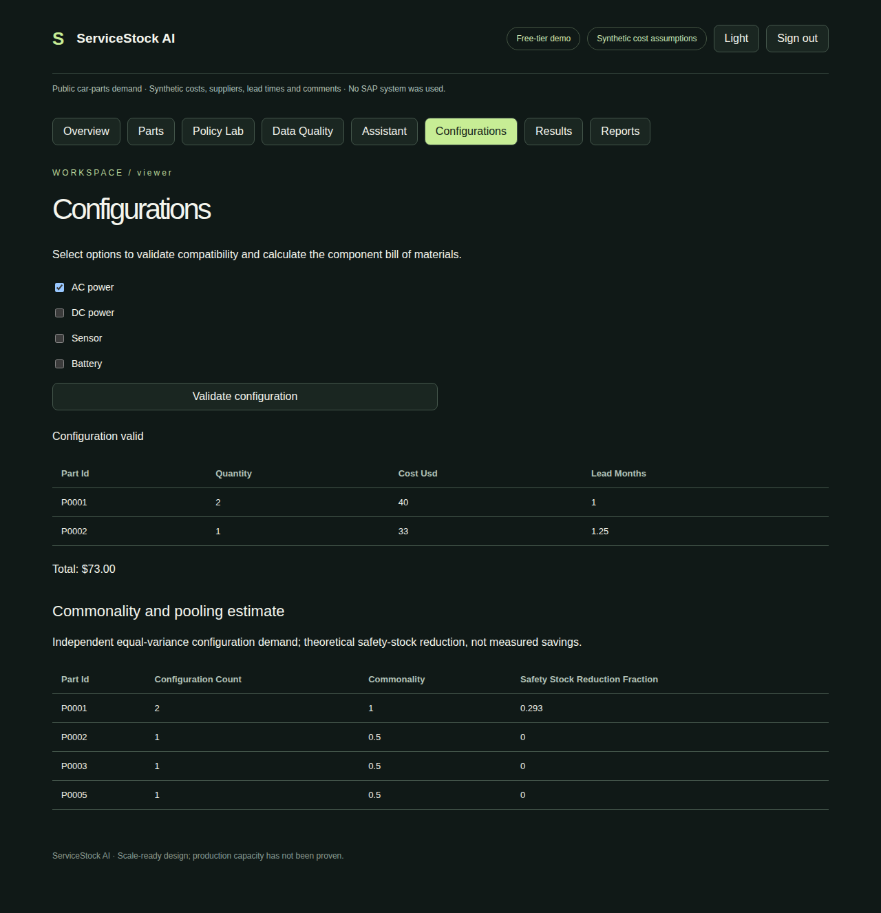

# ServiceStock AI

Companies that service installed equipment must hold spare parts. Too much stock locks up
working capital and adds holding cost. Too little stock causes stockouts, delayed repairs
and expensive expedited shipping. ServiceStock AI compares stock policies for intermittent
demand, explains their cost/service tradeoffs, and answers questions from verified tool results.

**Synthetic cost assumptions.** All costs, lead times, criticality, suppliers, configurations,
orders, invoices and comments are synthetic. Demand uses the first 24 public Monash car-parts
series; the source replaces missing observations with zero. No real company's data or SAP
system was used. NLP labels are synthetic. PostgreSQL is the default database.

## Run locally

Requirements: Docker Compose, Python 3.11+, and enough disk for initial image downloads.

```sh
make up
```

Open http://localhost:3000. Local credentials are generated into ignored `.env`; read
DEMO_PASSWORD or ADMIN_PASSWORD locally and sign in as `demo` or `admin`. Never share that file.
Demo is read-only. Initial build requires internet; subsequent starts use cached images and data.
`make down` stops the stack without deleting the database volume. No billing or cloud setup is needed.

## Verification and regeneration

```sh
python3.11 -m venv api/.venv
api/.venv/bin/pip install -r api/requirements-dev.txt -r api/requirements-compute.txt
api/.venv/bin/python -m pytest -q
cd web
npm ci
npm test
npm run typecheck
npm run build
cd ..
make results
```

Run `make benchmark PYTHON=...` with the compute environment to regenerate forecasts;
`cd api && .venv/bin/python -m app.analytics.compute` generates simulation/grid/finance/NLP
artifacts. `make results` renders docs/RESULTS.md solely from artifacts. Rebuild the API to
republish local artifacts. Playwright browser tests use generated local credentials and the
running stack; install Chromium with `npx playwright install chromium` first.

## Implemented

- PostgreSQL migrations, public-data cache, quarantine and seeded synthetic assumptions.
- Six forecast baselines/models, held-out comparisons, TreeSHAP and seeded policy simulation.
- Synthetic regression, NLP baseline, distribution comparisons and finance scorecard.
- Argon2id/JWT authentication, role/ownership checks, CSRF and rotating refresh cookies.
- Durable leased jobs, retention, measured DB usage, bounded cache and rate limits.
- Typed offline assistant tools, citations and SSE endpoint; no external LLM calls.
- Connected workspace, configuration validity/BOM/commonality, streamed PDF review pack.

## Results and limitations

See [measured results](docs/RESULTS.md), [phase ledger](docs/PHASES.md), and
[honest implementation report](docs/HONEST_REPORT.md). Negative capital savings are retained.
This is a local demonstration; full master-spec completion and production scale are not claimed.
SQL Server DDL compilation is tested, but runtime integration is not yet verified.
External LLM chain, full SAP-style ETL, zero-shot NLP comparison and detailed UI/operational
gates remain incomplete. No deployment has been performed.

## Design and deployment

[Architecture](docs/ARCHITECTURE.md) · [Methods](docs/METHODS.md) · [Security](docs/SECURITY.md) ·
[Threat model](docs/THREAT_MODEL.md) · [Free deployment](docs/DEPLOY_FREE.md) ·
[Free-tier budget](docs/FREE_TIER_BUDGET.md) · [BI model](docs/BI_DATA_MODEL.md)



Screenshot: local synthetic demonstration. Additional overview/detail screenshots are pending.
