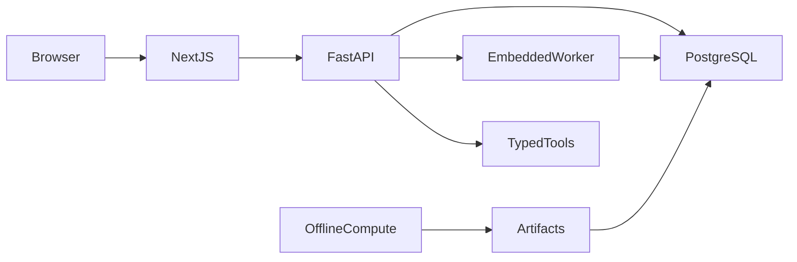

# Architecture

The Next.js same-origin proxy forwards authenticated API requests. FastAPI verifies JWT and
current database role on each protected request. SQLAlchemy uses short transactions and local
Postgres statement/lock timeouts. Health does not query the DB; readiness queries only when called.

Enqueue persists an owner-scoped idempotent job and signals an in-process event. Claims use
SKIP LOCKED on Postgres, with leases, fenced completion, retries and dead letters. The worker
queries only while handling a wake or outstanding retry/lease. Standalone mode drains existing
work then exits; long-lived external wake transport is not yet implemented.

Compute scripts write compact JSON (no raw simulation draws); local seed publishes those
artifacts. HTTP reads serve persisted results. No PDFs persist on disk in the API.
